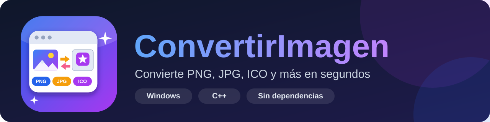
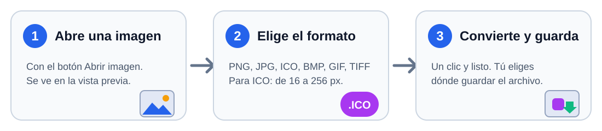

<p align="center">
  
</p>

<p align="center">
  
  
  
  
</p>

<p align="center">
  <b>Una app pequeña, rápida y sin instalación para convertir imágenes entre PNG, JPG, ICO, BMP, GIF y TIFF.</b><br>
  Abre, mira la vista previa, elige el formato y guarda.
</p>

 **Release Descarga:** [Release](https://github.com/xyvenqorix/ConvertirImagen/releases/tag/ConvertirImagen)
---

## ✨ ¿Qué es?

**ConvertirImagen** es una aplicación de escritorio para Windows, escrita en C++ con la API de Windows (Win32), que convierte una imagen de un formato a otro: de `png` a `ico`, de `jpg` a `png`, de `ico` a `png`, y cualquier otra combinación.

No necesita instalar nada, no usa librerías externas y el ejecutable resultante es un solo archivo.

## 🚀 Características

- 🔄 **Cualquier formato a cualquier formato**: PNG, JPG, ICO, BMP, GIF y TIFF, tanto de entrada como de salida.
- 🖼️ **Vista previa** de la imagen antes de convertir, con fondo de cuadritos para ver la transparencia.
- 🎯 **Tamaño de ICO a elegir**: 16, 32, 48, 64, 128 o 256 px, con la transparencia intacta.
- 🎨 **JPG de alta calidad** (92 %), con fondo blanco donde la imagen era transparente.
- 🛡️ **No toca tu archivo original**: siempre se guarda un archivo nuevo y te avisa antes de sobrescribir.
- 🪶 **Ligera y portable**: un solo `.exe`, sin instalador ni dependencias.
- 🔇 **Sin ventana de consola** de fondo.

## 🧭 Cómo se usa

<p align="center">
  
</p>

1. Abre `ConvertirImagen.exe`.
2. Pulsa **Abrir imagen...** y elige tu archivo. Lo verás en la vista previa.
3. En **Convertir a:** elige el formato de salida. Si es ICO, elige también el tamaño.
4. Pulsa **Convertir y guardar** y elige dónde guardarlo.

<!-- Cuando tengas una captura de pantalla, súbela a assets/ y descomenta esta línea:
<p align="center"></p>
-->

## 🛠️ Compilar

Solo necesitas un compilador de C++ para Windows. El código es C++ clásico (sin C++11) y no requiere enlazar librerías adicionales.

| Compilador | Pasos |
|---|---|
| **Cualquiera con MinGW** | Doble clic en `compilar.bat`. Genera `ConvertirImagen.exe` sin consola y con icono. |
| **MinGW (consola)** | `windres ConvertirImagen.rc -O coff -o icono.o`<br>`g++ ConvertirImagen.cpp icono.o -o ConvertirImagen.exe -mwindows -static` |
| **Visual Studio** | Crea un **proyecto vacío** de C++, agrega `ConvertirImagen.cpp` y `ConvertirImagen.rc`, y compila. El subsistema Windows ya se fuerza desde el código. |
| **Dev-C++ / Code::Blocks** | Crea un proyecto *Windows Application*, agrega `ConvertirImagen.cpp` y `ConvertirImagen.rc`, y compila. |

> [!NOTE]
> El archivo `ConvertirImagen.rc` es el que pone el icono al propio `.exe` (el que ves en el Explorador). El icono de la ventana ya va incrustado en el código, así que se ve aunque compiles sin el `.rc`.

## ⚙️ ¿Cómo funciona por dentro?

La app no se enlaza con ninguna librería: carga `gdiplus.dll` y `comdlg32.dll`, que ya vienen con Windows, cuando arranca. Después:

1. Abre la imagen con GDI+ y la copia a memoria, así el archivo original no queda bloqueado.
2. Muestra la vista previa en un búfer aparte, sin parpadeos.
3. Al convertir, vuelve a codificar la imagen con el codificador de GDI+ del formato elegido (PNG, JPG, BMP, GIF o TIFF).
4. Para **ICO**, GDI+ no sabe guardarlo, así que la app escribe el contenedor `.ico` a mano: la imagen se redimensiona al tamaño elegido, se codifica como PNG y se guarda dentro de la cabecera de iconos.

## ⚠️ Limitaciones y preguntas frecuentes

<details>
<summary><b>¿Qué formatos acepta?</b></summary>

Para abrir: PNG, JPG, BMP, GIF, TIFF e ICO. Para guardar: PNG, JPG, ICO, BMP, GIF y TIFF.
</details>

<details>
<summary><b>¿El ICO trae varios tamaños dentro?</b></summary>

No. Cada conversión genera un `.ico` con **un solo tamaño**, el que elijas. Si necesitas uno con varios tamaños (16, 32, 48 y 256), se puede ampliar en el futuro.
</details>

<details>
<summary><b>¿Qué pasa con la transparencia?</b></summary>

PNG, ICO, GIF y TIFF la conservan. JPG no admite transparencia, así que esas zonas se rellenan de blanco.
</details>

<details>
<summary><b>¿Y con los GIF animados?</b></summary>

Solo se convierte el primer fotograma.
</details>

<details>
<summary><b>Me sale un error al guardar</b></summary>

- Comprueba que tienes permiso de escritura en esa carpeta (por ejemplo, `Program Files` está protegida).
- Si el archivo de destino está abierto en otro programa, ciérralo y vuelve a intentarlo.
</details>

<details>
<summary><b>¿Qué versión de Windows necesito?</b></summary>

Windows Vista o superior, porque los `.ico` con PNG dentro se leen desde esa versión. Se recomienda Windows 10 u 11.
</details>

## 📁 Estructura del repositorio

```text
ConvertirImagen/
├─ ConvertirImagen.cpp   # Código fuente de la aplicación
├─ ConvertirImagen.rc    # Recurso que pone el icono al propio .exe
├─ icono.ico             # Icono de la aplicación
├─ compilar.bat          # Compila todo con un doble clic (MinGW)
├─ LICENSE
├─ README.md
└─ assets/
   ├─ banner.svg         # Cabecera del README
   ├─ logo.svg           # Logo en vector
   └─ como-funciona.svg  # Diagrama de uso
```

## 📄 Licencia

Distribuido bajo la licencia **MIT**. Consulta el archivo `LICENSE`.
